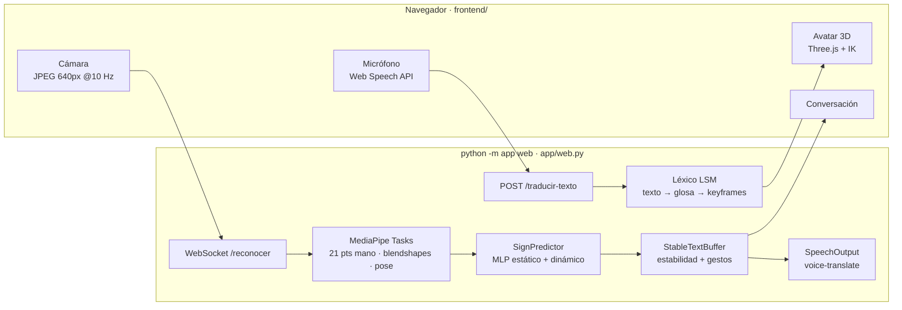

<div align="center">

# 🤟 Voz abierta

**Puente en tiempo real entre la Lengua de Señas Mexicana y el español hablado, para que el salón de clases funcione en las dos direcciones.**

El maestro habla y un avatar 3D lo seña. El alumno seña frente a la cámara y la computadora lo dice en voz alta.<br/>
Todo corre en una laptop, sin GPU y sin mandar video a la nube.

`Python 3.11` · `MediaPipe Tasks` · `scikit-learn` · `Three.js` · `Blender` · `Web Speech API` · `Coqui TTS`

*Prototipo para el AI Hackathon por México × Clara*

</div>

---

## El problema

Un alumno sordo que usa **LSM** suele estar en un salón donde nadie más la conoce, y casi nunca hay un intérprete disponible. Las herramientas que existen traducen en **un solo sentido** (de voz a subtítulos), así que el alumno puede leer al maestro, pero el maestro no puede entender al alumno.

## La solución

**Voz abierta** es una sola pantalla que comparten el alumno y el maestro:

| Dirección | Qué pasa | Tecnología |
|---|---|---|
| **Maestro → Alumno** | El maestro escribe o dicta; el texto se convierte en glosa LSM y un **avatar 3D** la seña, con el texto sencillo de apoyo. | Web Speech API → léxico LSM → IK en Three.js |
| **Alumno → Maestro** | El alumno seña frente a la cámara; aparece texto en vivo y el mensaje final **se lee en voz alta**. | MediaPipe (manos + cara + pose) → clasificador → TTS |

> **Privacidad por diseño:** el video nunca sale de la máquina ni se guarda en disco. Solo se procesan vectores de landmarks. Si configuras Gemini, solo recibe la secuencia de letras en texto plano.

---

## Demo en 2 minutos

```powershell
git clone https://github.com/ElorichV/Voz-abierta.git
cd Voz-abierta
python -m venv .venv
.\.venv\Scripts\pip install -r requirements.txt
.\.venv\Scripts\python.exe -m app web
```

Abre **http://127.0.0.1:8000** en Chrome o Edge y permite la cámara y el micrófono.

En el primer arranque, la app se prepara sola:
1. Descarga los modelos de MediaPipe (`hand`, `face` y `pose_landmarker`).
2. Entrena un **clasificador inicial de 24 letras** con un dataset público de landmarks (~97 % en validación). Corre en CPU.

Prueba rápida: escribe *"hola, ¿cómo estás?"* como maestro y mira al avatar señar. Luego enciende la cámara y sostén una letra (A, B, L…) quieta un momento.

> Sin backend: `cd frontend && python -m http.server 8000` abre el **modo demo** con datos simulados, útil para presentar la interfaz sin cámara.

---

## Arquitectura



**Decisiones clave**

- **Un solo pipeline, tres superficies.** `app run` (OpenCV), `app web` (navegador) y `app collect` usan los mismos `PerceptionTracker`, `SignPredictor` y `StableTextBuffer`. Lo que entrenas en uno funciona en los demás.
- **Umbrales independientes del frame rate.** La web manda 10 cuadros/s y la webcam nativa lee 30. Los contadores de estabilidad y la ventana dinámica se reescalan (`web.frame_rate_hz`), así que un gesto dura lo mismo en ambos modos.
- **Features invariantes.** Los landmarks se normalizan en traslación, escala y lateralidad: una mano izquierda se espeja a la canónica y la distancia a la cámara no afecta.
- **Cero dependencias web nuevas.** El servidor HTTP y el WebSocket (RFC 6455) usan solo la biblioteca estándar, con validación de `Origin`, límites de tamaño y cabeceras JPEG verificadas antes de decodificar.
- **Cold start resuelto.** Si no existe `models/sign_classifier.joblib`, se genera con el dataset público y espejado. Tus muestras de `collect` lo reemplazan letra por letra.

```text
app/          CLI (collect · train · run · avatar · web) y servidor web unificado
perception/   MediaPipe Tasks: HandLandmarker, FaceLandmarker (blendshapes), PoseLandmarker
features/     Normalización invariante y ventana temporal
recognition/  Recolección a CSV, bootstrap público, entrenamiento e inferencia
text/         Buffer de estabilidad, anti-repetición, gestos de control, Gemini opcional
speech/       Adaptador SpeechOutput sobre ./voice-translate
avatar/       Rig de Blender, cinemática, léxico LSM y visor Three.js
frontend/     Aula Accesible: HTML + Sass (BEM) + ES modules, sin frameworks
tests/        Suite pytest determinista (no requiere cámara ni GPU)
```

---

## Comandos

| Comando | Para qué |
|---|---|
| `python -m app web` | **App completa** en `:8000`: maestro ↔ alumno con avatar, cámara y voz. Opciones: `--no-voice`, `--alphabet LSM`, `--lang es\|en`, `--port`. |
| `python -m app run` | Traductor de escritorio (OpenCV) de cámara a texto y voz. |
| `python -m app avatar` | Visor standalone del avatar LSM en `:8765`. |
| `python -m app collect` | Captura tus propias señas (150 muestras por letra estática, 20 secuencias por dinámica). |
| `python -m app train` | Entrena el clasificador; `--no-bootstrap` usa solo tus datos. |

En Windows, antepón `.\.venv\Scripts\python.exe` en lugar de `python`.

### Gestos de control (cámara)

| Acción | Gesto | Teclado (`app run`) |
|---|---|---|
| Aceptar letra | Sostener la seña estable (≥ 70 % de confianza) | — |
| Espacio | Abrir la boca ~0.8 s | `Espacio` |
| Borrar | Fruncir las cejas ~0.8 s | `Backspace` |
| Enviar y hablar | Levantar las cejas, puño izquierdo o **bajar las manos 1.5 s** (web) | `Enter` |

---

## Entrena el modelo con tus señas (recomendado para LSM)

El modelo inicial usa landmarks públicos de **ASL**. Muchas letras coinciden con LSM, pero no todas. Para tu alfabeto:

```powershell
.\.venv\Scripts\python.exe -m app collect --alphabet LSM
.\.venv\Scripts\python.exe -m app train   --alphabet LSM
```

| Alfabeto | Estáticas (Fase 1) | Dinámicas (Fase 2) |
|---|---|---|
| **ASL** | 24: `A–I, K–Y` | `J`, `Z` |
| **LSM** | 21: `A B C D E F G H I L M N O P R S T U V W Y` | `J K Ñ Q X Z` |

El entrenamiento imprime el accuracy de validación, el reporte por clase y la matriz de confusión.

---

## Configuración

Todo vive en [`config.yaml`](config.yaml): cámara, umbrales de MediaPipe, alfabeto, estabilidad, gestos, voz y web.

- **Gemini (opcional):** corrige el deletreo (`"H O L A"` → `"hola"`). Copia `.env.example` a `.env` y define `GEMINI_API_KEY`. Sin clave o sin conexión, todo sigue funcionando en local.
- **Cámara en Windows:** si no abre, activa *Configuración → Privacidad → Cámara → apps de escritorio*. El sistema prueba `CAP_DSHOW` y, si falla, `CAP_ANY`.
- **Micrófono:** el dictado usa Web Speech API (Chrome o Edge, con internet) y solo funciona en `localhost`/`127.0.0.1` o HTTPS.
- **Voz:** `requirements.txt` instala `coqui-tts` con ruedas precompiladas para Windows, sin Visual C++ Build Tools.

---

## Calidad

```powershell
.\.venv\Scripts\python.exe -m pytest -q
```

La suite cubre la normalización de landmarks, las trayectorias dinámicas, el buffer de estabilidad, los gestos, el entrenamiento y el bootstrap. También prueba el handshake y los frames WebSocket, los límites HTTP, la validación de `Origin` y la integridad del GLB del avatar. Todo corre sin cámara ni GPU.

---

## Roadmap

- [x] Traducción bidireccional en una sola app (`app web`)
- [x] Avatar 3D con IK orgánica, anti-interpenetración y muñecas con límites reales
- [x] Reconocimiento de letras estáticas y dinámicas con gestos faciales de control
- [x] Modelo inicial automático (sin cold start)
- [ ] Dataset LSM propio, multi-usuario y validado por la comunidad sorda
- [ ] Señas léxicas completas con un modelo secuencial (GRU/TCN) sobre manos, pose y cara
- [ ] Componentes no manuales en el avatar (expresión facial gramatical)
- [ ] Validación del léxico con intérpretes certificados de LSM

## Ética y alcance

Voz abierta es un **prototipo de asistencia, no un sustituto de un intérprete**. Las 80 señas del léxico son adaptaciones (`revisado_por_interprete: false`) y la animación es experimental: falta validarla con personas sordas e intérpretes certificados. Las decisiones de producto deben tomarse con la comunidad sorda.

## Créditos

- [MediaPipe](https://ai.google.dev/edge/mediapipe) (Google): detección de manos, cara y pose.
- [MakeHuman](https://github.com/makehumancommunity/makehuman): malla base del avatar (CC0).
- [ASL Static Landmarks v1](https://huggingface.co/datasets/Siruyy/asl-static-landmarks-v1): landmarks para el modelo inicial (CC-BY-4.0).
- [voice-translate](https://github.com/cccaballero/voice-translate): síntesis de voz.

---

<details>
<summary><b>Deep dive técnico</b>: avatar, servidor web y limitaciones del reconocimiento</summary>

### Avatar 3D en LSM (`avatar/`)

Avatar de torso de una mujer semirrealista (complexión media femenina, piel morena, ojos azules,
labios llenos, clavículas marcadas, bob corto azul despeinado con raya al lado y mechones sueltos,
top negro de tirantes y pantalón negro) con
brazos y manos rigueados que interpreta texto en español como Lengua de Señas Mexicana.

- **Malla (por defecto `--base makehuman`):** cuerpo y cara realistas a partir de la malla base de
  [MakeHuman](https://github.com/makehumancommunity/makehuman) (CC0, ver
  `avatar/blender/makehuman/LICENSE.ASSETS.md`) con targets de mujer joven mezclados. La columna,
  cuello y cabeza del rig se colocan en las articulaciones de MakeHuman; brazos y manos se reposan de
  la pose A a la pose T del rig (cada hueso se alinea en posición, dirección y longitud). Los pesos
  de calor se calculan en la pose A, con los brazos separados del torso. El top y el pantalón son
  copias suavizadas de la piel, con sus mismos pesos: suéter de manga larga y cuello redondo (holgado
  en el pecho) y pantalón; la piel cubierta se elimina. El antebrazo reparte sus pesos de forma
  gradual entre `lowerarm` y `lowerarm_twist` para que la pronación no "estrangule" la malla.
  Ojos cafés y cabello en ~95 mechones finos. Unas 147 k caras, GLB de ~9.3 MB.
  `--base procedural` conserva la malla anterior hecha por script (voxel remesh + QuadriFlow).
- **Pesos sin deformaciones:** bone heat + suavizado laplaciano sobre aristas, máx. 4 influencias por
  vértice y normalizados; la blusa copia los pesos de la piel y la piel cubierta se elimina para
  evitar que atraviese la ropa. `tests/test_avatar.py` verifica influencias y huesos del GLB.
- **Movimiento suave:** transiciones con perfil de mínimo jerk y un filtro críticamente amortiguado
  por articulación (`Signer.applySmoothed`) que elimina saltos entre fotogramas clave; cada seña
  mantiene una pausa (`HOLD`) para leerse con claridad.
- **Muñecas naturales:** la pronación/supinación se descompone (swing-twist) y va al hueso de torsión
  del antebrazo; la mano sólo conserva flexión/desviación dentro de `WRIST_LIMITS` (75°/28°, giro
  residual 12°), así no gira de forma imposible.
- **Brazo orgánico:** en cada fotograma se busca el giro del codo alrededor del eje hombro-muñeca
  que menos torsión exige al antebrazo (`Signer.solveArmOrganic`); codo, torsión, muñeca y posición
  tienen velocidad máxima, y las transiciones siguen un arco. `window.avatarProbe(texto)` mide el
  giro por fotograma: en todo el léxico el máximo bajó de ~160° a ~22° por fotograma (60 fps).
- **Sin interpenetraciones:** palma y yemas se empujan fuera de volúmenes de cabeza, cuello, pecho y
  abdomen (`Signer.avoidBody`) y las dos manos mantienen una separación mínima.
- **Aspecto:** materiales físicos (piel con *sheen*, cabello metálico con clearcoat, ojos húmedos) e
  iluminación de estudio con `RoomEnvironment`.

```bash
python -m app avatar            # visor en http://127.0.0.1:8765 (también: python -m avatar.server)
```

| Pieza | Archivo |
|---|---|
| Modelo + rig (54 huesos: columna, cuello, cabeza, clavículas, brazos con hueso de torsión, metacarpos y 3 falanges por dedo) generados por script en Blender 4.2 | `avatar/blender/build_avatar.py` → `avatar/web/assets/avatar.glb`, `avatar/data/rig_skeleton.json` |
| Cinemática directa de la mano (21 puntos compatibles con MediaPipe) y rangos articulares naturales/hiperelásticos | `avatar/kinematics.py` |
| "Entrenamiento": ajuste por mínimos cuadrados de ángulos articulares + orientación a landmarks reales | `avatar/train.py` → `avatar/data/handshapes_trained.json` |
| Biblioteca de configuraciones (entrenadas + clasificadores LSM diseñados, incl. hiperextensión) | `avatar/handshapes.py` → `avatar/web/assets/handshapes.json` |
| Texto → glosa LSM (tiempo al inicio, interrogativos al final, lematización) → señas o deletreo | `avatar/lexicon.py`, `avatar/data/lexicon_lsm.json`, `avatar/data/alphabet_lsm.json` |
| Ingesta de diccionarios PDF (PyMuPDF) al formato del léxico | `avatar/ingest_pdf.py` |
| Visor Three.js con IK de dos huesos, orientación de palma/dedos y reparto de pronación entre antebrazo y muñeca | `avatar/web/` |

Regenerar el modelo: `blender -b -P avatar/blender/build_avatar.py -- --out avatar/web/assets/avatar.glb`.

Reentrenar configuraciones: `python -m avatar.train --hf-asl --csv data/landmarks_static.csv --csv-alphabet LSM`
(`--hf-asl` descarga el dataset público *ASL Static Landmarks v1*, CC-BY-4.0; el CSV propio sale de
`python -m app collect`). Después: `python -m avatar.handshapes`.

Ampliar el léxico desde un PDF: `python -m avatar.ingest_pdf diccionario.pdf --fuente "Manos con Voz (SEP/CONAPRED, 2011)"`.
Las entradas sin `keyframes` se animan a partir de `descripcion_movimiento`.

**Limitaciones.** Las configuraciones LSM se inicializan con landmarks de ASL donde la forma de la mano
coincide; conviene recapturar el alfabeto LSM con `python -m app collect` y reentrenar. Las 80 señas del
léxico son descripciones adaptadas (`revisado_por_interprete: false`) y deben validarse con
intérpretes de LSM. No hay expresión facial (componente no manual).

### Servidor web unificado

El servidor sirve el frontend en `/`, el visor compartido en `/avatar/`, el endpoint de salud en `/salud`, la traducción de texto en `POST /traducir-texto` y el reconocimiento WebSocket en `/reconocer`. La respuesta de traducción incluye `secuencia` (glosa y fotogramas clave) para el avatar. El host predeterminado es `127.0.0.1` (`--host`); el tiempo de manos abajo se configura en `web.hands_down_seconds`.

### Limitaciones del reconocimiento

1. **Confusión entre puños cerrados frontales (`A`, `E`, `M`, `N`, `S`, `T`)**:
   - En una sola vista 2D/2.5D frontal, la diferencia entre `M`, `N`, `T` y `S` depende de bajo qué dedos se asoma la punta del pulgar, lo que sufre auto-oclusión.
   - **Cómo mitigarlo al capturar muestras**: durante `collect`, graba ~50 muestras adicionales de `M`, `N`, `T`, `S`, `A` y `E` inclinando la mano $15^\circ\text{--}25^\circ$ hacia la cámara para que el detector vea claramente la posición del pulgar.
2. **Similitud geométrica entre `U` / `V` / `R` y `G` / `H` / `P` / `Q`**:
   - `U` (índice y medio juntos) y `R` (índice y medio cruzados) tienen distancias entre puntas muy similares; capturar con buena iluminación frontal mejora la separación en el eje X/Z.
3. **Iluminación a contraluz o desenfoque por movimiento rápido**:
   - En señas dinámicas (`J`, `Z`, `Ñ`), un movimiento brusco con poca luz puede hacer perder el tracking de MediaPipe por 1–2 frames.

</details>
